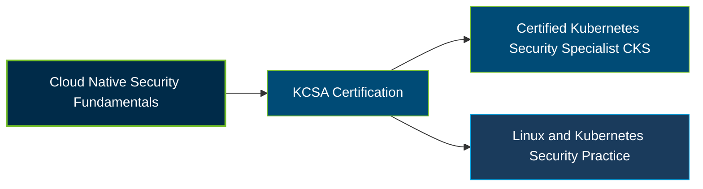

# Linux Foundation Kubernetes and Cloud Native Security Associate (KCSA) Certification Exam Guide

A dedicated, comprehensive study guide and security reference repository for candidates preparing for the **Linux Foundation Kubernetes and Cloud Native Security Associate (KCSA) Certification Exam**.

---

## Exam Overview

The KCSA certification validates foundational knowledge of cloud-native security, Kubernetes security controls, threat modeling, platform protection, and security compliance.

- **Exam Format**: Online, proctored, multiple-choice exam
- **Target Audience**: Aspiring cloud security professionals, Kubernetes practitioners, DevOps engineers, and IT security learners
- **Prerequisites**: None

---

## Core Exam Domains & Knowledge Areas

### 1. Overview of Cloud Native Security

- The 4Cs of cloud-native security: Cloud, Cluster, Container, and Code.
- Cloud provider and infrastructure security controls.
- Isolation techniques, artifact repositories, image security, and application code security.

### 2. Kubernetes Cluster Component Security

- Security responsibilities of the API server, controller manager, scheduler, and kubelet.
- Container runtime, kube-proxy, Pod, and etcd security.
- Container networking, client security, and Kubernetes storage.

### 3. Kubernetes Security Fundamentals

- Pod Security Standards, Pod Security Admission, and workload isolation.
- Authentication, authorization, secrets management, and segmentation.
- Audit logging and Kubernetes NetworkPolicy.

### 4. Kubernetes Threat Model

- Kubernetes trust boundaries, data flows, and threat identification.
- Persistence, denial-of-service risks, and malicious code execution.
- Network-based attacks, sensitive data exposure, and privilege escalation.

### 5. Platform Security

- Software supply chain security and image repository protection.
- Observability, service mesh, and Public Key Infrastructure (PKI).
- Secure connectivity and admission control.

### 6. Compliance and Security Frameworks

- Cloud-native compliance and security frameworks.
- Threat modeling methodologies and risk assessment.
- Supply chain compliance, security automation, and tooling.

---

## Certification Path

This diagram shows a suggested learning progression, not a mandatory certification sequence. KCSA does not require prerequisites; CKS is a possible future goal for candidates who meet its separate CKA prerequisite.

---

## Recommended Practice & Study Resources

Combine official certification guidance with Kubernetes security documentation and practical cloud-native security exercises.

- **Official Linux Foundation Resources**: Review the [KCSA certification page](https://training.linuxfoundation.org/certification/kubernetes-and-cloud-native-security-associate-kcsa/), examination handbook, and official curriculum.
- **CertsGate**: Explore [KCSA certification preparation resources](https://certsgate.com/exams/linux-foundation/kcsa) for supplementary study materials and practice questions.
- **Practical Kubernetes Security**: Study the [Kubernetes security documentation](https://kubernetes.io/docs/concepts/security/) and [CNCF KCSA curriculum](https://github.com/cncf/curriculum/blob/master/KCSA%20Curriculum.pdf) to review cluster security, threat models, and compliance concepts.
